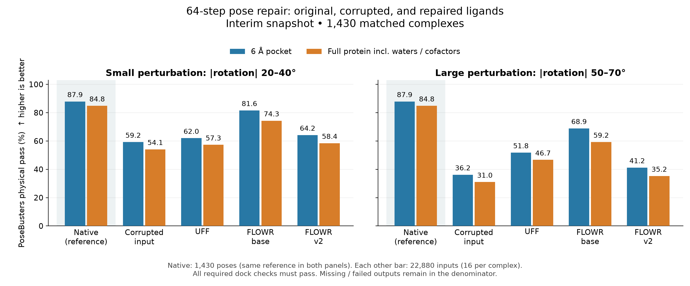
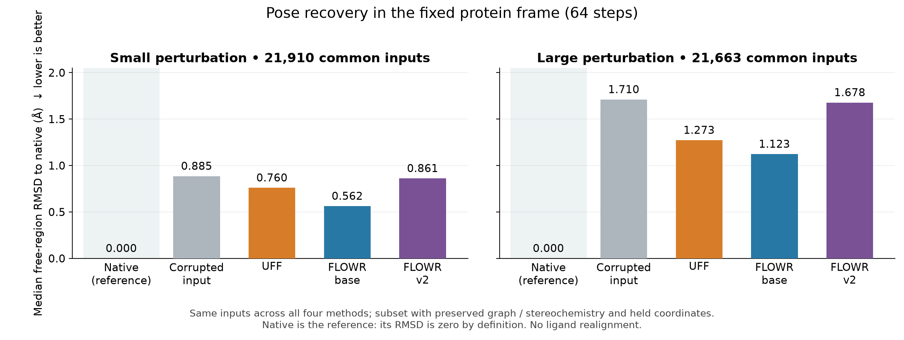

# 원본을 포함한 64-step pose 복구 비교

앞선 분석과 같은 1,430개 완료 복합체의 고정 snapshot이다. 원본은 1,430개, 각 오차·방법의 입력은 22,880개다. 현재 진행 중인 실험의 조건이나 결과 파일은 변경하지 않았다.

원본은 흐트러뜨리기 전 native 좌표다. 원본 좌표에 UFF를 적용하지 않았다. 원본의 RMSD는 기준 좌표 자신과 비교하므로 0 Å이며, 종합 복구 성공 여부는 적용하지 않는다.

원본 PoseBusters 통과: pocket 1,257/1,430 (87.90%), 전체 protein 1,213/1,430 (84.83%).

| 오차 | 방법 | Pocket 물리 통과 | 전체 protein 물리 통과 | 종합 성공 |
| --- | --- | ---: | ---: | ---: |
| none | native | 87.90% | 84.83% | — |
| small | input | 59.20% | 54.10% | — |
| small | UFF | 61.98% | 57.28% | 44.45% |
| small | base | 81.58% | 74.31% | 65.36% |
| small | v2 | 64.19% | 58.44% | 41.47% |
| large | input | 36.17% | 31.00% | — |
| large | UFF | 51.77% | 46.66% | 39.86% |
| large | base | 68.89% | 59.23% | 57.28% |
| large | v2 | 41.22% | 35.21% | 26.56% |

UFF는 ligand 내부 에너지를 줄이는 Universal Force Field 최소화다. 수소를 추가하고 보호 heavy atom 좌표를 고정한 채 최대 200회 최소화한 뒤 수소를 제거한다. Protein 상호작용 에너지 항은 사용하지 않는다. FM 출력에 UFF를 후처리한 결과가 아니라, 같은 흐트러진 입력에 UFF만 적용한 별도 대조군이다.

작은/큰 오차는 각각 말단 회전 가능 결합 주위의 절대 회전각 20–40° / 50–70°다. 자유 영역은 metric과 무관하게 결정적으로 선택한 2–8개 heavy atom이며, 나머지 좌표와 화학 그래프는 유지한다. 각 수준에서 seed가 다른 16개의 입력을 만든다.

물리 통과는 PoseBusters dock preset의 선택된 20개 이진 검사 전체 통과다. 원본 ligand와의 identity/RMSD 검사는 이 함수에 포함하지 않으며 별도로 계산한다. Pocket은 native 기준 고정 6 Å 영역이고, 전체 protein 검사는 원본 파일의 물·보조인자도 포함한다.

종합 성공은 ① graph/입체화학 보존 AND ② 보호 좌표 최대 변위 ≤0.001 Å AND ③ pocket 물리 검사 통과 AND ④ 자유 영역의 native RMSD가 흐트러진 입력보다 감소인 경우다. Vina·QED·SA를 합산한 점수가 아니다. 감소량의 최소 임계값이나 1 Å 이내 조건은 이 종합 성공 정의에 포함하지 않는다.

RMSD 그림은 모든 방법에서 graph/입체화학 및 보호 좌표를 보존하고 RMSD 계산이 가능한 공통 입력만 사용한다. 물리 통과 그림은 생성 실패·누락을 분모에 유지한다. 두 그림의 분모를 구분해야 한다.
