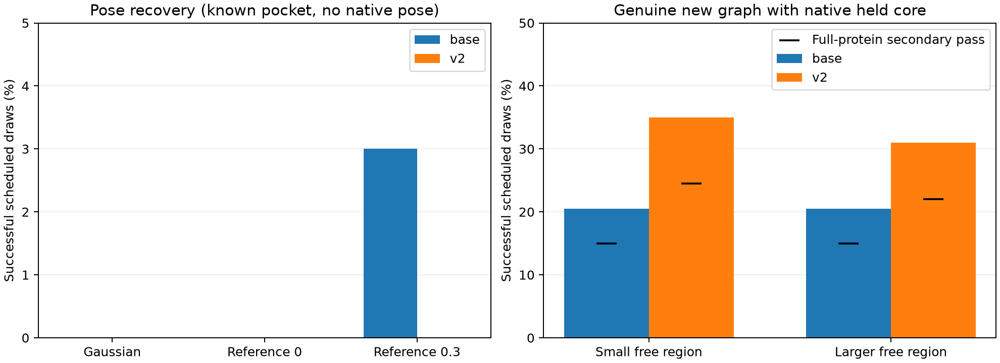

# GPU 3 FLOWR 생성 품질 — 최종 검토

생성 2,000회와 전체 protein 추가 검사를 완료했다. 원본 저장 결과를 읽어 분석했으며 새 GPU 생성·학습은 하지 않았다.

## 핵심 판단

현재 DIRMO 설정에서 v2는 native core를 조건으로 한 fragment 생성에서 base보다 높은 통과율을 보였다. 결합 pose를 제공하지 않는 전체 graph 고정 pose 복구는 두 checkpoint 모두 매우 낮은 성공률이었다. 유효한 새 분자가 나왔다는 사실과 QED·SA·Vina가 좋아졌다는 사실은 별도로 평가했다.

## 실험 범위

- PDBbind2019의 적격 복합체 20개, seeds 42–51, Euler 64-step, 두 checkpoint × 다섯 조건 × 200 draws = 2,000 draws / 130,000 NFE.
- LLM/router 호출 0. 추가 학습 없이 기존 weights를 비교했다. checkpoint hash와 실제 GPU 3 UUID는 원본 study/health에 있다.
- Pose 입력은 native 정렬 없는 ETKDG conformer를 pocket 중심에 배치했다. 초기 median RMSD는 4.403 Å, 초기 PB 통과는 0/20이다. Native pose는 evaluator만 읽었다.
- Fragment는 native ligand 전체를 전처리 입력으로 사용하고 지정된 held 영역의 graph·좌표를 고정했다. 자유 영역 prior에도 reference 위치 정보가 관여하므로, core만 제공한 독립 초기화 실험으로 해석하지 않는다. 주어진 정보가 pose 과제와 달라 두 과제의 성공률을 직접 경쟁시키지 않는다.
- Native pose의 PB 통과는 pocket에서 17/20, 원본 전체 protein에서 16/20이었다.

## 저장·재읽기 문제를 구분한 분석

134개 pose 출력에서 worker의 graph 통과와 SDF 재읽기 결과가 달랐다. MDL의 STEREOANY 표지가 E/Z 복원을 막는 사례를 확인했다. 원본 좌표를 그대로 둔 복사본에서 bond annotation을 지우고 atom/bond stereo를 XYZ로 다시 계산하면 134건 모두 worker의 graph와 일치했다. Native 20개에도 이 방법을 적용해 모두 원래 graph와 일치함을 확인했다.

원래 metric과 SDF는 변경하지 않았다. 재검사는 별도 JSONL로 남겼다. Pose 성공 6건이라는 결론은 바뀌지 않았다. Fragment에서는 30개가 실제 화학 변화 없이 E/Z annotation 누락만으로 새 graph로 집계됐으므로 다음 표는 이를 제외한다.

## Pose 결과

성공 = 좌표에서 복원한 exact graph + pocket PB 통과 + protein frame RMSD ≤2 Å. 각 행은 200회다.

| 조건 | base | v2 |
| --- | ---: | ---: |
| random | 0/200 | 0/200 |
| reference0 | 0/200 | 0/200 |
| reference03 | 6/200 | 0/200 |

base reference03의 6건은 모두 1pot 한 target에서 나왔다. 전체 protein 검사에서도 이 6건은 통과했다. Seed 6개를 서로 다른 target 6개로 해석하지 않는다. Reference0은 모든 target에서 10 seeds가 동일 좌표 1개를 반환해 추가 다양성을 제공하지 않았다.

Gaussian 조건에서는 400개 모두 결합 길이·각 검사에 실패했다. V2 pose 조건은 600개 모두 protein 접촉 검사에 실패했다. NFE와 raw-prior 좌표 차이를 확인해 모델 forward가 실제 실행되고 좌표도 바뀌었음을 확인했다.

이 결과는 잘못 배치한 초기 conformer의 전역 복구 결과다. 기존 bound pose 주변의 작은 보정이나 편집 후 retained-atom alignment를 하는 production 경로의 성능을 직접 측정한 결과가 아니다. Whole-graph 조건의 학습 이력은 원본 metadata만으로 미확인이다.

## Fragment 결과

성공 = held atom/charge/bond·좌표 보존 + PB 통과 + 좌표 stereo를 복원한 실제 graph 변화. 각 행은 200회다. 마지막 열은 원본 protein의 물·보조인자 좌표까지 고정해 검사한 추가 기준이다.

| checkpoint | 자유 영역 | 원래 집계 | 실제 변화 확인 후 | 전체 protein 추가 통과 |
| --- | --- | ---: | ---: | ---: |
| base | fragment_large | 48/200 | 41/200 (20.5%) | 30/200 (15.0%) |
| base | fragment_small | 41/200 | 41/200 (20.5%) | 30/200 (15.0%) |
| v2 | fragment_large | 74/200 | 62/200 (31.0%) | 44/200 (22.0%) |
| v2 | fragment_small | 81/200 | 70/200 (35.0%) | 49/200 (24.5%) |

편집 영역은 metric이나 PLIP 결과를 보고 선택하지 않았다. fragment_regions는 ring이 아닌 결합을 잘라 작은 말단 조각을 고르고, 큰 영역은 그 조각에서 이웃 원자로 확장한다. 동률은 원자 index로 결정하며 동일 case의 모든 seeds/checkpoints에서 같은 영역을 사용한다. Murcko scaffold는 복합체 중복 제거에만 사용했다. QED·SA·Vina 목표 또는 개선 방향은 모델에 입력하지 않았다.

추가 입력 감사에서 800개 fragment의 최종 held mask는 요청과 일치했다. 그러나 110회에서 자유 원자의 시작 좌표 일부가 같은 원자의 native 좌표와 0.001 Å 이내로 일치했고, 488회에서는 적어도 하나가 reference의 어느 원자 위치와 일치했다. 총 자유 슬롯 2700개 중 각각 274개와 1234개다. 후자는 서로 다른 원자 slot으로 복사된 위치도 포함하므로 해당 자유 원자의 정답 pose가 전달됐다는 뜻으로 모두 해석하지 않는다.

Upstream은 자체 fragment mask로 fixed/variable fragment를 구성하고 local prior를 reference의 자유 영역 중심에 배치한다. DIRMO는 이후 요청한 held mask와 held features를 덮어쓰지만, 모든 자유 feature를 독립 prior로 재초기화하지 않는다. 따라서 최종 고정 영역은 맞아도 자유 초기화는 완전히 통제되지 않았다. 기록된 시작 좌표에서 이 효과를 확인했으며 자유 discrete features는 저장되지 않아 사후에 직접 판정하지 않았다. 기존 생성 통과 수는 유지하되, 이를 엄밀한 core-only 조건부 생성 성능이나 모델 능력만의 차이로 해석하지 않는다. 증거는 fragment-prior-audit.json에 있다.


좌표 복원 후의 v2-base 차이는 small +14.5%p (target bootstrap 95% CI +4.5~+25.0%p), large +10.5%p (+0.5~+22.5%p)다. 전체 protein 추가 기준에서는 small +9.5%p (95% CI −1.5~+21.0%p), large +7.0%p (−5.0~+20.0%p)다. 추가 기준의 신뢰구간은 0을 포함하므로, 이 20-target 실험만으로 v2의 일반적인 우월성이나 small 영역의 최적성을 확정하지 않는다. 계산값은 comparison.json에 저장했다.

평가 가능한 745 fragment 출력에서 held 좌표 drift는 모두 0 Å였다. Held graph 위반은 base small/large 각각 3개, v2 small 1개, v2 large 0개였다. 좌표 고정은 sampler의 hard copy 효과도 포함하므로 모델 학습 능력의 단독 증거가 아니다.

Full PB에서 통과가 줄어든 주된 추가 원인은 water/protein 접촉이다. 물의 위치를 고정한 판정이며, 실제 binding에서 물이 이동·배출되는 효과를 모사한 결과는 아니다. Missing energy 계산을 통과로 바꾸지 않았다.

## 동일 receptor subset의 docking 비교

Receptor 준비에 성공한 11 targets에서 Vina docking 실제 poses는 109개였다. 좌표 stereo를 복원한 rank-1 성공은 2/11, PB/graph 통과 후 Vina 최소값으로 고르는 공통 selector는 3/11, oracle any-pose 성공은 6/11이다.

| FM 조건 | 공통 selector Top-1 | oracle any draw |
| --- | ---: | ---: |
| base random | 0/11 | 0/11 |
| base reference0 | 0/11 | 0/11 |
| base reference03 | 1/11 | 1/11 |
| v2 random | 0/11 | 0/11 |
| v2 reference0 | 0/11 | 0/11 |
| v2 reference03 | 0/11 | 0/11 |

이 비교는 동일 11 targets의 pocket PB 기준이며 full-protein FM 결과와 혼합하지 않는다. 후보 수와 계산 비용이 정확히 같지는 않다. 준비 실패한 나머지 9개는 숨기거나 FM 집계에서 제외하지 않았다.

## 성질 개선

실제 새 graph이며 조건/PB를 통과하고 Vina까지 측정된 후보 중 QED↑·SA↓·Vina↓로 native를 지배한 것은 6 draws, 2 targets, 2개의 target/graph 조합이다. Full-protein 추가 통과는 5 draws / 1 target/graph 조합이다.

| checkpoint | 조건 | 유효 새 graph | Vina까지 측정 | 세 지표 native 지배 |
| --- | --- | ---: | ---: | ---: |
| base | fragment_small | 41 | 21 | 0 |
| base | fragment_large | 41 | 26 | 2 |
| v2 | fragment_small | 70 | 45 | 3 |
| v2 | fragment_large | 62 | 35 | 1 |

V2 small 후보의 measured median 변화는 QED +0.0311, SA +0.1802, Vina +0.390이다. SA/Vina는 낮을수록 좋으므로 유효 생성의 상당수에서 일부 목적은 악화됐다. 높은 생성 통과율이 다목적 최적화 성공을 뜻하지 않는다.

대표 개선 사례는 1e6s, v2 fragment_small, seed 45다. 전체 protein 추가 검사도 통과했다.

| 지표 | 초기 ligand | 생성 ligand | 해석 |
| --- | ---: | ---: | --- |
| QED | 0.192 | 0.270 | 높을수록 좋음 |
| SA | 4.771 | 4.115 | 낮을수록 좋음 |
| Vina score | -5.437 | -6.417 | 낮을수록 좋음 |
| LogP | -3.179 | -3.606 | 목표 범위에 따라 판단 |

생성 SDF: [/home/uslee/code/DIRMO-3D/runs/fm_quality_gpu3_20261013_v1/draws/v2_fragment/1e6s/fragment_small/45/raw.sdf](/home/uslee/code/DIRMO-3D/runs/fm_quality_gpu3_20261013_v1/draws/v2_fragment/1e6s/fragment_small/45/raw.sdf)

Vina는 계산 점수이며 실험으로 측정한 결합 친화도가 아니다. LogP 감소를 자동으로 개선이라고 판정하지 않았다. 세 지표의 동시 개선 판정에는 QED·SA·Vina만 사용했다.

## 다음 단계

1. SDF E/Z roundtrip 및 fragment 자유 영역의 prior 초기화·mask 경로를 수정·검증한다. Metadata 차이를 화학 편집 학습 label로 사용하지 않고, 요청한 영역의 자유 초기화와 held 보존을 함께 확인한다.
2. Native core가 있는 지역 탐색에는 v2 fragment를 우선 사용하고 실제 구조 변화·held graph·물리 검사 및 각 metric을 모두 검증한다.
3. 전체 graph 고정 pose는 입력 prior·time embedding·self-conditioning·stereo 조건의 학습 preset 호환성을 확인한 뒤 같은 graph의 noisy-pose fine-tuning 필요성을 판단한다. 현재 낮은 성공률만으로 LLM tuning에 원인을 돌리지 않는다.
4. 실제 목적 개선은 metric vector와 Pareto 후보로 평가하고, 별도 target/scaffold 분리 데이터로 조건 선택을 확인한다. Native를 지배한 후보는 Pareto front와 동일한 개념이 아니다.

## 해석 한계와 재현

20 targets의 pilot이며 pretraining overlap은 미확인이다. Protein exact sequence와 non-empty Murcko scaffold를 중복 제거했지만 sequence-cluster split을 검증한 것은 아니다. Scalar utility, 실제 affinity, 전체 optimize 정책의 우월성을 측정하지 않았다. 두 FM 프로세스와 기존 작업이 GPU 3을 공유했으므로 latency는 단독 GPU benchmark가 아니다.

원본의 summary/analysis와 새 검토 결과는 구분해 보관했다. 원본 리포트는 기존 stereo 판정 기준의 집계이며, 본 검토는 좌표 복원으로 교차 확인한 결과다.

```bash
conda activate dirmo
cd ~/code/DIRMO-3D
python scripts/review_fm_quality.py --run runs/fm_quality_gpu3_20261013_v1 --output reports/fm-quality-review-2026-10-13
python scripts/audit_fm_fragment_conditions.py --run runs/fm_quality_gpu3_20261013_v1 --output reports/fm-quality-review-2026-10-13/fragment-prior-audit.json
python scripts/build_fm_quality_review.py --run runs/fm_quality_gpu3_20261013_v1 --output reports/fm-quality-review-2026-10-13
```



막대는 pocket 기준의 성공률, 검은 가로 표식은 전체 protein 추가 검사까지 통과한 성공률이다. 두 패널의 세로축 범위가 다르다. Pose와 fragment는 제공받은 조건이 달라 성공률을 직접 비교하지 않는다.
