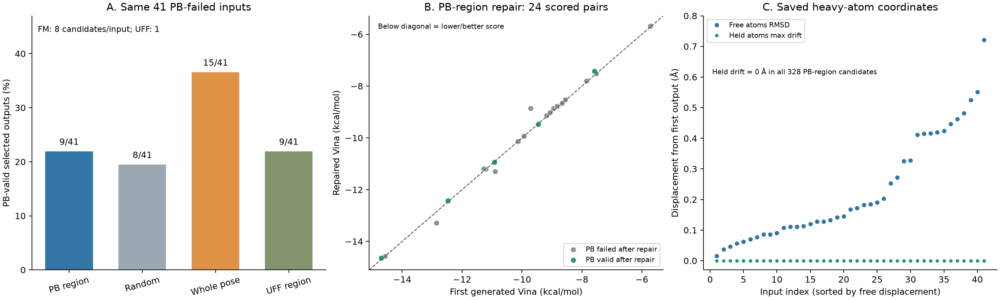

# PB 기반 pose 재생성: 화학 성질·Vina·고정 영역 검토

이번 앞단은 pocket 조건의 de novo SBDD 생성이고 뒤 단계는 생성된 graph를 유지하는 pose 보정이다. 원본 reference ligand는 binding site와 원자 수를 제공한다. 원자·결합을 바꾸는 화학 구조 최적화와 구분해야 한다.

## 대상과 후보 선택

100 pocket × 16개 = 1,600개 예정. 생성 실패 54개, PB 시간 초과 8개, PB 통과 1,459개, PB 실패 79개다. PB 실패 중 연결된 graph로 읽히고 허용된 영역에 위반 원자가 들어가는 41개 생성물(31 pocket)이 부분 복구 대상이다.

제외된 38개: 연결 graph 입력 없음 11개, 지역화 근거 없음 16개, 후보 영역에 위반 원자가 없음 10개, 크기·연결·ring 조건을 만족하는 영역 없음 1개다. 41은 임의로 제한한 개수가 아니다.

각 FM 방법은 같은 41개 입력당 8개 후보를 만들어 328개를 평가했다. 입력마다 PB와 graph/stereo·보호 좌표 보존 통과를 우선하고, 실패 검사 수·변위·후보 번호로 우선순위를 정해 한 개를 선택했다. 선택 결과 41개에는 복구 실패도 포함된다. UFF는 입력당 한 번의 대조군이다.

## 원본 PB 89%의 의미

원본 100개 중 11개가 실패했다. 단백질 최소 거리 10개, 내부 에너지 2개이며 1개는 중복이다. 일반 접촉 검사를 공유결합형 구조에도 그대로 적용한 대상·평가 조건의 문제가 일부 확인된다.

[1NPZ](https://www.rcsb.org/structure/1NPZ)와 [4YQU](https://www.rcsb.org/structure/4YQU)는 공유결합형 ligand를 포함한다. 로컬 원본의 가장 가까운 단백질 접촉은 각각 약 1.78 Å와 1.77 Å다. 이 거리를 일반 비공유결합 VDW 충돌로 판단하면 정상 공유결합도 실패 처리할 수 있다. 다른 거리 실패 8개까지 공유결합이라고 단정하지 않는다. native_failures.csv의 confirmed_covalent=False는 비공유결합이 증명됐다는 뜻이 아니라 해당 표에서 공유결합을 확인하지 않았다는 뜻이다.

[PoseBusters 논문](https://arxiv.org/html/2308.05777v3)도 crystal structure의 충돌과 임계값의 역할을 설명한다. PB는 유용한 물리적 타당성 검사지만 실험 구조 여부·결합력의 최종 판정은 아니다. 이후 공식 성능 비교에는 공유결합 구분, 단백질·ligand 전처리, PB 항목별 실패 원인 점검과 맞춘 benchmark가 필요하다. 실패를 보고 쉬운 표본으로 바꿔 기존 결과를 소급 수정해서는 안 된다.

## 부분 복구가 전체 pose보다 낮은 이유

부분 복구는 PB로 위반 위치를 골랐지만 PB 수치·위반 종류를 FM의 추가 목표나 gradient로 넣지 않았다. Mask는 어디를 바꿀 수 있는지 알려줄 뿐 무엇을 얼마나 바꿔야 PB가 통과하는지는 보장하지 않는다.

전체 위반 이벤트의 원자가 모두 자유 영역에 들어가는 입력은 5/41뿐이며, 2개는 위반 이벤트가 통째로 고정 영역에 남았다. 일부 원자만 움직여도 위반을 해결할 수 있으므로 나머지 36개가 복구 불가능하다는 의미는 아니다. 다만 작은 영역과 강한 고정이 복구 자유도를 제한했다는 근거다.

선택 결과에 남은 이중결합 평면성 실패는 부분 21개 대 전체 18개, 결합각 실패는 5개 대 2개다. 새 결합 길이 실패도 부분 선택 결과 1개에서 관찰됐다. 전체 pose는 여러 원자를 함께 움직여 구조를 조정할 수 있다. 별도의 PB 복구 학습 없이 graph/좌표 clamp를 사용한 현재 추론 방법과 checkpoint의 적합성도 가능한 원인이지만, 이 실험만으로 원인별 효과를 분리하지는 못한다.

무작위 대조군도 29/41개 입력에서 PB 영역과 같은 영역을 선택했다. 따라서 현재 결과로 위치 선택 자체의 큰 효과를 주장하기 어렵다.

## 같은 41개 입력의 화학 성질

아래는 PB 기반 부분 재생성의 입력·선택 결과 41쌍 평균이다. QED·SA·MW·LogP·HBD·HBA·TPSA·회전 결합·Lipinski 위반 수의 최대 변화는 모두 0이다. 동일 graph에서 좌표만 수정했으므로 예상되는 결과다.

| 항목 | 첫 생성물 평균 | 부분 재생성 선택 결과 평균 | 최대 절대 변화 |
| --- | ---: | ---: | ---: |
| QED | 0.4053 | 0.4053 | 0.0000 |
| SA (RDKit, 1–10) | 4.5526 | 4.5526 | 0.0000 |
| 분자량 (Da) | 525.5957 | 525.5957 | 0.0000 |
| LogP | 3.6999 | 3.6999 | 0.0000 |
| HBD | 2.2927 | 2.2927 | 0.0000 |
| HBA | 6.1463 | 6.1463 | 0.0000 |
| TPSA (Ų) | 108.7446 | 108.7446 | 0.0000 |
| 회전 가능 결합 수 | 5.9268 | 5.9268 | 0.0000 |
| Lipinski 위반 수 | 0.9512 | 0.9512 | 0.0000 |

## Affinity 대리 지표: 같은 pose의 Vina score-only

Vina score-only를 계산한 결과이며 실측 affinity, FLOWR affinity head의 예측, 재도킹 또는 최소화 결과가 아니다. Delta = 재생성 후 − 전, 단위 kcal/mol이며 음수가 점수 개선이다. 두 집단 median의 차이와 paired delta median은 다를 수 있다.

원본 단백질에서 표준 아미노산만 사용하고 물·보조인자·비표준 잔기는 제외했다. Heavy atom 좌표는 유지하고 Meeko template H와 Gasteiger charge를 사용했으며 HIS는 HIE로 고정했다. Box는 native 중심 40 Å이고 모든 짝에서 같은 receptor/box를 사용했다. 준비 상태가 다른 13 pocket에서 Meeko template matching에 실패하여 17/41 입력의 점수는 없다. 성공한 18 pocket의 24쌍에 대해서만 비교하며 결과를 41개 전체로 일반화하지 않는다. 누락 잔기를 자동으로 삭제하거나 새 좌표를 만들어 비교를 완성하지 않았다.

| 방법 | 유효 짝 | Vina 전 median | Vina 후 median | 짝별 Δ median | 개선 / 악화 |
| --- | ---: | ---: | ---: | ---: | ---: |
| PB 기반 부분 재생성 | 24 | -9.4545 | -9.2860 | +0.0230 | 8 / 16 |
| 무작위 부분 재생성 | 24 | -9.4545 | -9.4350 | +0.0155 | 9 / 15 |
| 전체 pose 재생성 | 24 | -9.4545 | -9.1280 | +0.2500 | 3 / 21 |
| 부분 UFF 보정 | 24 | -9.4545 | -9.2745 | +0.0915 | 4 / 20 |

부분 재생성은 Vina가 8쌍 개선·16쌍 악화했고 paired Δ median은 +0.023 kcal/mol이다. 작은 차이로 뚜렷한 affinity 개선을 주장할 수 없다. PB가 통과된 결과 중 Vina 짝도 있는 5개에서는 2개만 Vina가 개선됐다. PB 복구와 affinity 대리 점수 개선은 같은 목적이 아니다. UFF는 한 짝에 +12.753 kcal/mol의 큰 악화가 있어 mean과 median 차이가 크다.

## 고정 영역과 graph 검증

실제 첫 생성 raw SDF → 정규화된 repair_input SDF의 heavy atom 좌표 차이는 41/41개에서 0 Å였다. 실제 저장된 재생성 SDF 1,025개도 다시 읽어 검사했다. 정렬로 변위를 없애지 않고 동일 단백질 좌표계에서 비교했다.

| 방법 | 후보 수 | 고정 영역이 있는 후보 | 고정 heavy atom 최대 변위 | 입체화학 포함 보존 후보 | 선택 결과 보존 |
| --- | ---: | ---: | ---: | ---: | ---: |
| PB 기반 부분 재생성 | 328 | 328 | 0.0000 Å | 327/328 | 41/41 |
| 무작위 부분 재생성 | 328 | 328 | 0.0000 Å | 328/328 | 41/41 |
| 전체 pose 재생성 | 328 | 0 | 해당 없음 | 325/328 | 41/41 |
| 부분 UFF 보정 | 41 | 41 | 0.0000 Å | 40/41 | 40/41 |

PB 기반 부분 재생성의 선택 결과 41개는 graph/stereo가 모두 보존됐고, 자유 원자의 변위 RMSD median은 0.168 Å였다. 이는 첫 생성물에서 얼마나 수정됐는지를 뜻하며 실험 정답 pose와의 정확도가 아니다. 전체 후보 중 부분 1개, 전체 pose 3개, UFF 1개는 입체화학 보존 검사를 통과하지 못했다. QED 등 2D descriptor가 같아도 입체화학 보존을 대신 증명하지는 않는다.

## 그림 및 파일

- paired_selected_metrics.csv: 동일 입력과 선택 결과 164쌍, 화학 성질·PB·Vina 변화.
- chemical_properties.csv: 입력과 모든 재생성 후보의 화학 성질.
- preservation_all_candidates.csv / recomputed_preservation.csv: 모든 후보의 graph/stereo·고정 좌표 보존.
- raw_source_coordinate_audit.csv: raw 첫 생성물과 실제 재생성 입력의 좌표 비교.
- paired_vina_summary.csv / vina_all_ligands.csv: 방법별 집계 및 측정·누락 상태.
- analysis_review.json: 별도 검증 결과·해시·조건.

## 근거

- [FLOWR.root 공식 구현](https://github.com/jule-c/flowr_root): PDB 입력에서 reference ligand로 pocket 정의; base는 generation-only checkpoint.
- [FLOWR.root 논문](https://arxiv.org/html/2510.02578v3): pocket 조건 SBDD 생성 및 reference 크기 주변 크기 조건의 benchmark 설정.
- [PoseBusters 논문](https://arxiv.org/html/2308.05777v3): 물리 검사와 crystal structure 충돌에 대한 설명.
- [RCSB 1NPZ](https://www.rcsb.org/structure/1NPZ), [RCSB 4YQU](https://www.rcsb.org/structure/4YQU): 공유결합형 복합체.
