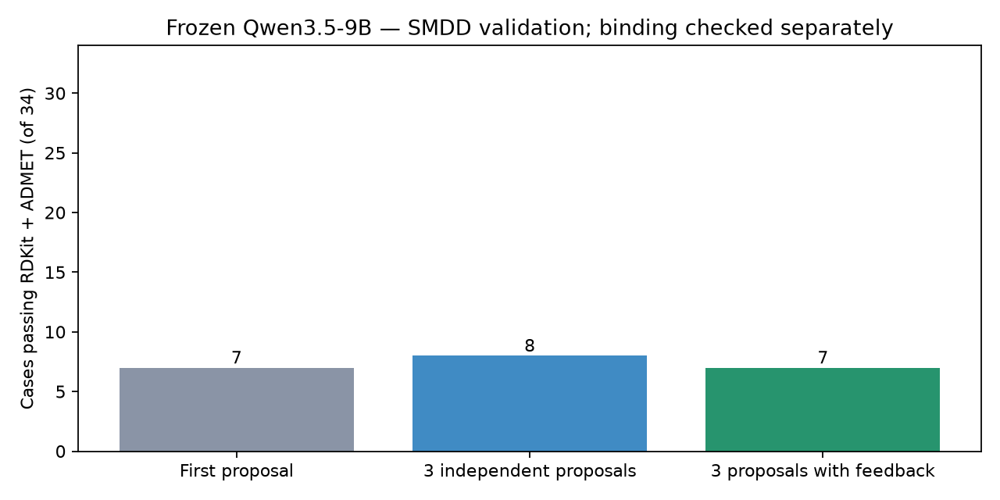
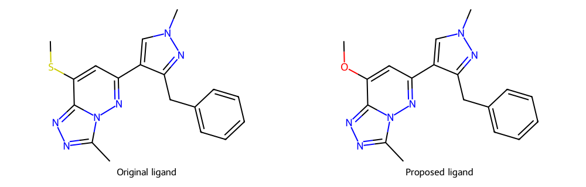

# 학습 없는 편집·도구 피드백 validation 결과

Qwen3.5-9B base 모델로 **validation 34개 전체**를 실행했다. LoRA, encoder, projector, 가중치 업데이트는 사용하지 않았다. Train/test와 witness 정답을 입력에 사용하지 않았다.

Original과 current 분자 물성·원자/작용기 정보를 구조화해 전달하고, 한 문장 편집 가설과 전체 SMILES를 받았다. RDKit·ADMET 실패값을 다음 제안에 넣어 수정했다.

과제당 방식별 3개 제안을 사용했다. 첫 제안은 공유했고 실제 HTTP 요청은 **170회**, 평가 기록은 **204개**다. 서버는 thinking=false, seed=42, temperature=0.7, top_p=0.8, top_k=20, BF16이며 physical GPU 4를 사용했다. ADMET-AI 1.4.0은 격리된 CPU 환경에서 계산했다.

## 조건 통과 결과

| 과제 단위 지표 | 피드백 없는 3회 제안 | 도구 피드백 3회 제안 |
|---|---:|---:|
| 최초 제안 RDKit·ADMET 통과 | 7/34 | 7/34 |
| 유효 graph가 한 번 이상 생성됨 | 31/34 | 31/34 |
| 변경된 ligand의 로컬 제약 통과가 한 번 이상 있음 | 18/34 | 22/34 |
| 선택된 후보 RDKit·ADMET 통과 | 8/34 | 7/34 |
| Boltz 포함 전체 성공 확인 | 3/34 | 3/34 |
| 선택된 후보의 결합 조건 미측정 | 5/34 | 4/34 |

RDKit·ADMET 통과는 전체 성공이 아니다. 전체 성공에는 Boltz binding probability > 0.7과 해당 task의 affinity 목표/유지 조건이 추가로 필요하다. 미측정은 실패로 확정하거나 성공으로 계산하지 않는다.

| 제안 단위 지표 | 피드백 없음 | 도구 피드백 |
|---|---:|---:|
| 정확한 편집 JSON 형식 | 102/102 | 102/102 |
| 유효한 분자 graph | 91/102 | 92/102 |
| 변경 및 로컬 제약 통과 | 43/102 | 41/102 |
| ADMET 검사 시행 | 43/102 | 41/102 |

## 결과 해석

처음에는 RDKit·ADMET를 통과하지 못했지만 feedback 수정 후 통과한 과제는 **0개**다. 최초 제안의 통과 수는 7개, 3회 independent의 통과 수는 8개, feedback의 통과 수는 7개다. 같은 호출 수에서의 관측이며 통계적 유의성이나 일반적인 성능 우위를 보장하지 않는다.

과제당 유효 graph의 평균 종류 수는 independent 1.32, feedback 2.09다. Worker가 요청마다 같은 seed를 쓰므로 independent는 제안 순서만 바꿔도 같은 분자를 반복할 수 있다. 다양한 sampling seed를 사용한 독립 후보 생성과의 비교는 별도 실험이 필요하다.

Feedback 제공과 current ligand 변경을 함께 적용했으므로 두 효과를 분리하지 않았다. 편집 위치·가설의 타당성을 label로 평가한 실험도 아니다. 실제 도구로 계산한 조건의 통과 여부를 평가했다.

RDKit·ADMET 통과 후보 중 ADMET 개선 목표가 있는 과제는 independent 7개, feedback 6개다. Binding만 개선 목표인 과제는 각각 1개, 1개다. 후자는 ADMET 유지 조건을 통과했을 뿐 개선 목표인 affinity를 확인한 수치가 아니다.

### Target별 선택된 후보

| Target | 개수 | Independent pre-Boltz | Feedback pre-Boltz |
|---|---:|---:|---:|
| BChE | 1 | 0 | 0 |
| BRAF | 8 | 3 | 2 |
| BRD4 | 17 | 3 | 3 |
| CYP19A1 | 8 | 2 | 2 |

### 많이 실패한 조건

- independent: `admet:bbb` 17회, `rdkit:tanimoto` 16회, `rdkit:brenk` 16회, `rdkit_parse:Invalid molecular graph or SMILES` 11회, `admet:clearance` 10회, `rdkit:logp` 8회. 한 제안에서 여러 조건이 실패할 수 있다.
- feedback: `edit:Must change the original ligand` 20회, `admet:bbb` 16회, `rdkit:brenk` 16회, `admet:clearance` 14회, `rdkit:tanimoto` 12회, `rdkit_parse:Invalid molecular graph or SMILES` 10회. 한 제안에서 여러 조건이 실패할 수 있다.

## Boltz 검증

선택된 후보의 중복을 제거한 요청 8개 중 3개를 측정했고 5개는 미측정이다. Seed 42, sampling steps 200, structure/affinity 각 10 draws를 사용했다.

이번 실행은 `--memory-fraction 0.24 --min-free-mib 13000 --max-parallel-samples 1`을 사용했다. 초기 GPU context 생성 후 여유가 약 13,448 MiB였으며 작은 protein 입력은 프로세스 상한과 1 GiB의 여유 예약 내에서 실행했다. 400 residue 이상 입력은 이전 BRAF OOM 기록을 반영한 보수적 조건인 30,000 MiB 여유를 만족하지 못해 실행하지 않았다.

- `smdd_004_BRD4_11` (independent, feedback): binding probability 0.9888, affinity improvement -0.0400, 전체 통과 `True`.

`solubility`: -3.9819 → -3.3481, 개선량 0.6338 ≥ 목표 0.5000.

`cyp3a4`: 0.7150 → 0.5157, 개선량 0.1993 ≥ 목표 0.1000.

Affinity는 -1.6924 → -1.6524로 악화량 0.0400가 유지 허용치 0.3000 이내다. 이 과제는 affinity 개선을 요구하는 대신 유지 조건을 적용한다.

- `smdd_004_BRD4_14` (independent, feedback): binding probability 0.9994, affinity improvement 0.0339, 전체 통과 `True`.

`solubility`: -5.6957 → -4.4477, 개선량 1.2480 ≥ 목표 0.5000.

`ames`: 0.4024 → 0.1239, 개선량 0.2785 ≥ 목표 0.1000.

`herg`: 0.8518 → 0.4977, 개선량 0.3541 ≥ 목표 0.1000.

- `smdd_004_BRD4_6` (independent, feedback): binding probability 0.9890, affinity improvement 0.2450, 전체 통과 `True`.

`clearance`: 107.8367 → 96.4480, 개선량 11.3887 ≥ 목표 5.0000.

Affinity는 -1.4523 → -1.6973로 0.2450 개선되어 유지 조건도 통과했다. 이 과제는 affinity 개선을 요구하는 대신 유지 조건을 적용한다.

- `smdd_004_CYP19A1_14`: 미측정, `conservative_long_protein_memory_limit`. 세부 실행 로그와 자원 한계는 run/boltz/results.json 참조.
- `smdd_004_CYP19A1_7`: 미측정, `conservative_long_protein_memory_limit`. 세부 실행 로그와 자원 한계는 run/boltz/results.json 참조.
- `smdd_004_BRAF_1`: 미측정, `conservative_long_protein_memory_limit`. 세부 실행 로그와 자원 한계는 run/boltz/results.json 참조.
- `smdd_004_BRAF_3`: 미측정, `conservative_long_protein_memory_limit`. 세부 실행 로그와 자원 한계는 run/boltz/results.json 참조.
- `smdd_004_BRAF_8`: 미측정, `conservative_long_protein_memory_limit`. 세부 실행 로그와 자원 한계는 run/boltz/results.json 참조.

## 수정 사례

- `smdd_004_BRD4_0`: round 2 후보 선택, RDKit·ADMET 전체 통과 `False`. ADMET 실패 조건 수 3 → 1.

LLM 편집 가설: Replace the methyl group at atom 8 with a fluorine atom to reduce lipophilicity and metabolic clearance while maintaining steric bulk.

생성 SMILES: `Cn1cc(-c2cc(F)ccc2OCC2CCCCC2)c2cc[nH]c2c1=O`

- `smdd_004_BRD4_17`: round 3 후보 선택, RDKit·ADMET 전체 통과 `False`. ADMET 실패 조건 수 2 → 1.

LLM 편집 가설: Replace the terminal methyl group of the sulfonamide ethyl chain with a hydrogen atom to reduce molecular weight and clearance while preserving the core scaffold.

생성 SMILES: `CCOc1cc(=O)n(C)cc1-c1cc(NS(=O)(=O)C)ccc1Oc1ccc(F)cc1F`

- `smdd_004_BRAF_8`: round 3 후보 선택, RDKit·ADMET 전체 통과 `False`. 초기 ADMET 미측정(로컬 탈락); 수정 후 ADMET 실패 조건 1개.

LLM 편집 가설: Replace the methyl group on the piperazine nitrogen (atom 18) with a hydrogen to reduce lipophilicity and CYP3A4 inhibition risk.

생성 SMILES: `Cc1ccc(C(=O)Nc2ccc(CN3CCNCC3)c(C(F)(F)F)c2)cc1NC(=O)c1cncnc1`

가설은 LLM 출력 그대로이며 원인 설명의 정확성은 검증하지 않았다. 일부 조건 개선과 전체 통과는 다르다.

위 2D 구조는 `smdd_004_BRD4_11`의 original과 모델 제안이다. Boltz 3D 결과와 구분되는 graph 도식이며 설명한 편집 위치의 정확성을 자동 검증한 그림은 아니다.

## 비용·재현과 파일

총 input token 453,978, output token 17,186, model generation 시간 합계 30.5분이다. 공유된 첫 제안은 실제 요청/전체 token에서 중복 계산하지 않았다.

Oracle의 ADMET 값은 예측값이며 실험 측정이 아니다. 공식 baseline은 그대로 사용했다. Reference 재예측 차이는 `reference_audit.json`에 기록했다. 같은 graph라도 원래 SMILES 표기에 따른 legacy Chemprop 차이가 가능하므로 예측 숫자 변화만으로 분자 개선의 원인을 단정하지 않는다.

- [실행 및 prompt 코드 안내](../../docs/smdd_feedback.md)
- [집계 JSON](summary.json), [수정 사례](examples.json)
- [전체 통과 확인된 출력](successful_predictions.json)
- [실제 입력 예시](example_input.json), [실제 출력 예시](example_output.json)
- [프로토콜](../../runs/smdd_feedback_01/protocol.json)
- [모든 HTTP 입력·출력](../../runs/smdd_feedback_01/llm_calls.jsonl)
- [모든 도구 검사](../../runs/smdd_feedback_01/attempts.jsonl)
- [Run 결과](../../runs/smdd_feedback_01/report.json)
