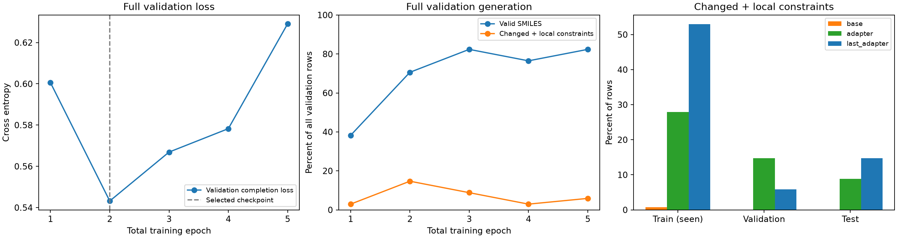

# SMDD-Bench 전체 결과

Qwen3.5-9B rank-8 LoRA를 GPU 4에서 선택 경로 기준 총 5 epoch 학습했습니다.
이전 1 epoch의 adapter에서 warm start했으며 LR 후보 두 개를 동일한 시작 가중치로 비교했습니다.
Validation이 악화되어도 학습을 중단하지 않았습니다.

- 선택된 peak LR: `5e-05` (비교한 후보 내 선택).
- 최종 평가에 사용한 best checkpoint: 총 2 epoch.
- 마지막 5-epoch checkpoint도 별도 보관.
- Training microbatch 8, generation batch 4.
- 최대 tensor GPU memory: 27.68 GiB.
- 학습·LR 비교·base/best 전체 평가 시간: 70.9분 (마지막 checkpoint 및 ADMET 추가 평가 시간 제외).

## LR 비교 — validation 34개 전체

| LR | Completion loss | 유효한 SMILES | 변경 + 로컬 제약 통과 |
|---:|---:|---:|---:|
| 2e-05 | 0.5685 | 23/34 | 1/34 |
| 5e-05 | 0.5432 | 24/34 | 5/34 |

선택은 변경+로컬 제약 통과 수, 유효한 SMILES 수, 낮은 loss 순서입니다.
Loss만 낮아진 checkpoint를 자동으로 선택하지 않았습니다. Test 결과는 선택에 사용하지 않았습니다.

## 선택 경로의 epoch별 validation

| 총 epoch | LR | Completion loss | 유효한 SMILES | 변경 + 로컬 제약 통과 |
|---:|---:|---:|---:|---:|
| 1 | 이전 실행 | 0.6006 | 13/34 | 1/34 |
| 2 | 5e-05 | 0.5432 | 24/34 | 5/34 |
| 3 | 3.75e-05 | 0.5669 | 28/34 | 3/34 |
| 4 | 2.8125e-05 | 0.5783 | 26/34 | 1/34 |
| 5 | 2.109375e-05 | 0.6291 | 28/34 | 2/34 |

## 최종 전체 split 평가

`base`는 adapter가 없는 모델, `adapter`는 validation의 **로컬 제약 기준**으로 선택한 best checkpoint,
`last_adapter`는 마지막 5-epoch checkpoint입니다.

| Split | Model | 전체 row | Completion loss | 엄격한 JSON | 유효한 SMILES* | 변경 + 로컬 제약* |
|---|---|---:|---:|---:|---:|---:|
| train | base | 272 | 0.9661 | 64/272 | 122/272 | 2/272 |
| train | adapter | 272 | 0.3218 | 272/272 | 206/272 | 76/272 |
| train | last_adapter | 272 | 0.1313 | 272/272 | 244/272 | 144/272 |
| validation | base | 34 | 1.0955 | 13/34 | 13/34 | 0/34 |
| validation | adapter | 34 | 0.5432 | 34/34 | 24/34 | 5/34 |
| validation | last_adapter | 34 | 0.6291 | 34/34 | 28/34 | 2/34 |
| test | base | 34 | 0.9021 | 5/34 | 18/34 | 0/34 |
| test | adapter | 34 | 0.4699 | 34/34 | 17/34 | 3/34 |
| test | last_adapter | 34 | 0.5466 | 34/34 | 19/34 | 5/34 |

별표 항목은 완전한 Markdown fence만 제거한 뒤 검사한 값입니다.
SMILES의 결합/원자/문법 오류는 수정하지 않았습니다. 엄격한 출력 검사도 원본 JSON에 별도 기록했습니다.

## 해석 범위

모든 train 272 / validation 34 / test 34를 평가했습니다. Train은 학습에 사용한 분자 쌍에 대한
fitting 진단이고, 일반화 평가는 validation/test를 기준으로 해야 합니다. 초기 split은 단백질 서열,
동일 분자, nonempty scaffold를 공유하는 과제의 연결 그룹을 나눈 것입니다.
단백질 homology clustering까지 적용한 원격 상동 단백질 평가로 해석할 수는 없습니다.
표적 이름 기준 train 18 / validation 4 /
test 3개 표적을 포함합니다. 각 표적의 과제 수가 같지 않으므로
전체 row 평균은 과제 수가 많은 표적의 영향을 더 받습니다. 전체 표적별 집계는 `per_target.json`에 있습니다.

| Test target | Model | 과제 수 | 유효 SMILES | 변경+로컬 제약 통과 |
|---|---|---:|---:|---:|
| ABL1 | base | 6 | 3 | 0 |
| Aurora_A | base | 4 | 2 | 0 |
| Cathepsin_K | base | 24 | 13 | 0 |
| ABL1 | adapter | 6 | 3 | 0 |
| Aurora_A | adapter | 4 | 0 | 0 |
| Cathepsin_K | adapter | 24 | 14 | 3 |
| ABL1 | last_adapter | 6 | 3 | 0 |
| Aurora_A | last_adapter | 4 | 0 | 0 |
| Cathepsin_K | last_adapter | 24 | 16 | 5 |

`변경 + 로컬 제약`은 유효한 변경 분자가 RDKit 물성·필터·유사도 제약을 모두 만족했다는 뜻입니다.
ADMET-AI와 Boltz 조건을 모두 포함하는 **전체 SMDD 최적화 성공률이 아닙니다**.
추가 ADMET 측정 결과와 held-out Boltz 결합 조건 평가 결과는 아래에 분리했습니다.
Witness exact match는 imitation 지표이며 유일한 성공 기준이 아닙니다.
Graph metric delta는 각 응답에 저장했고 임의의 utility로 합치지 않았습니다.

마지막 checkpoint의 train completion loss는 0.1313,
유효 SMILES는 244/272,
witness exact match는 58/272입니다.
Validation completion loss는 best의 0.5432에서
0.6291로 바뀌었고, 변경+로컬 제약 통과는
5/34에서
2/34로 바뀌었습니다.
Test의 변경+로컬 제약 통과는 3/34에서
5/34로 바뀌었습니다.
Train fitting이 좋아지는 동안 validation loss가 상승해 overfitting 경향이 있습니다.
일부 test 지표는 좋아졌으므로 모든 test 성능이 악화되었다고 단정할 수 없습니다.
전체 test에서 로컬·ADMET 조건을 함께 통과한 출력은 세 모델 모두 0건입니다. Loss 감소나 출력 형식 개선을 목표 달성으로 해석하면 안 됩니다.

## ADMET-AI v1.4.0 추가 평가

전체 모델의 유효한 SMILES에 공식 버전 ADMET-AI를 실행했습니다. 값은 실험값이 아니라 모델 예측입니다.
Checkpoint 선택에는 사용하지 않았습니다.
모델 응답의 **원문 product_smiles**로 측정했습니다. RDKit graph 검사용 canonical SMILES로
바꿔 넣지 않습니다. 전체 Markdown fence만 제거할 수 있으며 분자 자체는 수정하지 않았습니다.
기존 canonical 입력 계산은 `admet_canonical_diagnostic/`에 진단용으로 보관했습니다.

| Split | Model | ADMET 목표 전체 통과/측정 가능 | ADMET hold 통과/유효 SMILES | 필수 조건 실패 확인 | Boltz 미검증 후보 |
|---|---|---:|---:|---:|---:|
| train | base | 32/112 | 26/122 | 272/272 | 0 |
| train | adapter | 21/189 | 165/206 | 262/272 | 10 |
| train | last_adapter | 83/226 | 213/244 | 192/272 | 80 |
| validation | base | 6/12 | 9/13 | 34/34 | 0 |
| validation | adapter | 5/21 | 14/24 | 33/34 | 1 |
| validation | last_adapter | 3/25 | 13/28 | 33/34 | 1 |
| test | base | 9/18 | 4/18 | 34/34 | 0 |
| test | adapter | 3/16 | 12/17 | 34/34 | 0 |
| test | last_adapter | 0/19 | 15/19 | 34/34 | 0 |

ADMET 목표가 없는 binding-only 과제는 ADMET 목표 통과율의 분모에서 제외했습니다.
표의 Boltz 미검증 후보는 이미 로컬·ADMET 조건을 통과한 것으로 결합 관련 검증이 추가로 필요합니다.
다른 필수 조건을 실패한 후보는 Boltz를 실행해도 전체 과제 성공으로 인정할 수 없습니다.
상세 개선량과 hold 실패는 `admet/{base,adapter,last_adapter}/{train,validation,test}/conditions.jsonl`에 있습니다.

### 로컬 제약을 통과한 test 출력의 실패 조건

변경이 없는 reference 복사도 로컬 제약 통과 수에 들어갈 수 있으므로 변경 여부를 별도로 표시합니다.
각 목표의 수치와 개선량은 원본 conditions.jsonl에 있습니다.

| Model | Test task | Reference 변경 | 실패한 ADMET 목표 | 실패한 hold |
|---|---|---|---|---|
| adapter | smdd_004_Cathepsin_K_10 | True | 없음 | herg |
| adapter | smdd_004_Cathepsin_K_21 | True | cyp3a4 | 없음 |
| adapter | smdd_004_Cathepsin_K_23 | True | clearance, ppb, ames, cyp3a4 | 없음 |
| last_adapter | smdd_004_Cathepsin_K_13 | False | ppb, clearance | 없음 |
| last_adapter | smdd_004_Cathepsin_K_14 | True | bbb | 없음 |
| last_adapter | smdd_004_Cathepsin_K_18 | True | clearance, bbb | 없음 |
| last_adapter | smdd_004_Cathepsin_K_22 | False | ppb | 없음 |
| last_adapter | smdd_004_Cathepsin_K_23 | False | clearance, ppb, ames, cyp3a4 | 없음 |
| last_adapter | smdd_004_Cathepsin_K_3 | True | clearance | 없음 |
| last_adapter | smdd_004_Cathepsin_K_6 | True | ppb, solubility | 없음 |
| last_adapter | smdd_004_Cathepsin_K_7 | False | caco2 | 없음 |
| last_adapter | smdd_004_Cathepsin_K_8 | True | ames | caco2 |

### 원본 label과 baseline 재현 audit

원본 witness.smi 340개 중 9개가 현재 ADMET oracle에서 목표 또는 hold 조건을
재현하지 못했습니다. Reference 재예측 2720개 속성값 중
1278개가 공개 baseline과 1e-3보다 크게 달랐고,
최대 절대 차이는 6.5311였습니다.
목표 판정은 공개 baseline을 그대로 사용했습니다. 현재 수치는 공식 조건을 적용한 로컬 재평가이며,
이 재현 차이를 감안해야 합니다. 차이의 원인은 확정하지 않았고 임계값을 임의로 완화하지 않았습니다.

| Witness task | Split | 재현 실패 조건 |
|---|---|---|
| smdd_004_BAZ2B_5 | train | goal:ames |
| smdd_004_BCL6_22 | train | goal:bbb |
| smdd_004_BRD2_15 | train | hold:cyp3a4 |
| smdd_004_BRD2_20 | train | goal:cyp3a4 |
| smdd_004_DHODH_1 | train | hold:clearance |
| smdd_004_DHODH_16 | train | goal:clearance |
| smdd_004_DHODH_22 | train | hold:solubility |
| smdd_004_DHODH_4 | train | goal:clearance |
| smdd_004_BRD4_9 | validation | hold:clearance |

자세한 예측값·차이는 `admet/reference_and_witness_audit.json`에 있습니다.

## Held-out Boltz 결합 검증

모든 필수 로컬·ADMET 조건을 통과한 held-out 후보에만 Boltz 2.2.1을 실행했습니다.
앞 단계에서 실패한 출력도 전체 평가 분모에 포함합니다. 상태: `complete`.
단백질 FASTA의 모든 chain과 task.yaml의 pocket, seed 42,
구조·affinity diffusion sample 각각 10, diffusion step 각각 200을 사용했습니다.
로컬 기준 checkpoint를 고정한 뒤 실행했고 이 결합 결과는 선택에 사용하지 않았습니다.
Affinity 개선량은 Boltz의 `affinity_pred_value` (log10 IC50, IC50 단위 μM) 감소량입니다.
ADMET 목표와 hold를 통과한 뒤 결합 확률·친화도 조건까지 통과해야 전체 조건 통과로 집계합니다.

| Split | Model | 전체 조건 통과 | 필수 조건 실패 | 미확정 |
|---|---|---:|---:|---:|
| validation | base | 0/34 | 34/34 | 0 |
| validation | adapter | 0/34 | 34/34 | 0 |
| validation | last_adapter | 1/34 | 33/34 | 0 |
| test | base | 0/34 | 34/34 | 0 |
| test | adapter | 0/34 | 34/34 | 0 |
| test | last_adapter | 0/34 | 34/34 | 0 |

| Model | Candidate | Binding probability (>0.7 필요) | Affinity 개선량 (>=0.3 필요) | 결합 조건 통과 |
|---|---|---:|---:|---|
| last_adapter | smdd_004_BRD4_7 | 0.9827 | 0.4246 | True |
| adapter | smdd_004_BRAF_1 | 0.3475 | -0.8220 | False |

이번 측정에서는 마지막 5-epoch 모델의 BRD4 후보 1개가 전체 조건을 통과했고,
로컬 기준으로 선택한 2-epoch 모델의 BRAF 후보는 결합 확률·친화도 목표를 실패했습니다.
따라서 낮은 validation completion loss나 높은 로컬 제약 통과 수가 전체 목표 달성의
최고 checkpoint를 보장하지 않았습니다. 두 checkpoint는 그대로 보관하며 test에 맞춰 다시 선택하지 않습니다.

Train에서 앞 단계를 통과한 후보 90개는
결합 검증을 진행하지 않았으며 train의 전체 최적화 성공률은 미확정입니다.
상세 값, 실제 실행 명령과 실패 로그는 `boltz_heldout/report.json`, 각 후보의 `boltz.log`에 있습니다.
전체 조건을 통과한 예시는 `successful_predictions.json`에 원문 응답, 로컬·ADMET·Boltz 측정을 함께 저장했습니다.
이 평가도 모델 예측 기반이며 실험적 친화도 검증이나 공식 multi-turn leaderboard 결과는 아닙니다.

## 코드와 산출물

- [전체 학습 안내](../../docs/smdd_full_training.md)
- [학습·평가 코드](../../src/dirmo/training/smdd_full.py)
- [CLI](../../scripts/train_smdd_full.py)
- [ADMET 평가](../../scripts/evaluate_smdd_admet.py)
- [Boltz 평가](../../scripts/evaluate_smdd_boltz.py)
- 실행 폴더: `runs/smdd_full_01/experiment`
- 모델: `best_adapter/`, `last_adapter/`, `checkpoints/`.
- 모든 응답 원문: `final/{base,adapter,last_adapter}/{train,validation,test}/predictions.jsonl`.
- 집계: `report.json`, `full_results.json`, `split_metrics.csv`.

PLIP 특징은 현재 입력에 추가하지 않았습니다. Reference의 상호작용을 atom map/잔기/거리/각도로
구조화하는 별도 비교 실험을 권합니다. Witness 상호작용은 input에 넣지 않습니다.
PLIP은 결합 친화도나 ADMET 측정을 대신하지 않습니다.
