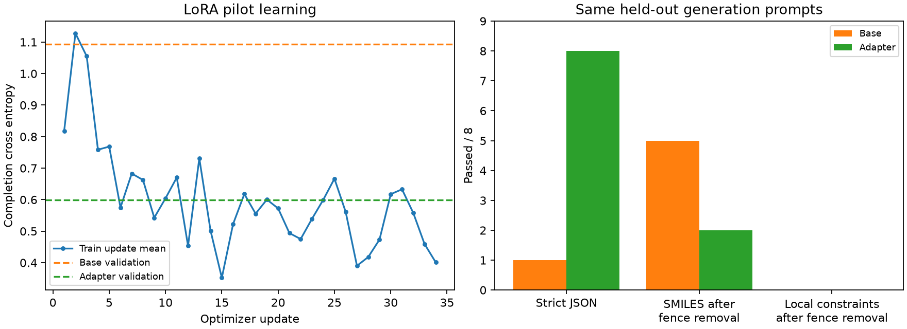

# SMDD-Bench LoRA pilot 결과

Qwen3.5-9B를 GPU 4에서 1 epoch 학습했습니다. 실행 위치: `runs/smdd_lora_02`.

이번 결과에서는 JSON 형식이 개선됐지만, fence를 제거한 SMILES 유효성은
5/8에서
2/8로 낮아졌습니다.
Adapter의 로컬 제약 전체 통과는 0/8입니다.
형식 학습과 분자 편집 능력을 구분해야 하며, 이번 pilot은 최적화 성능 개선을 보여주지 못했습니다.

Train 272 / validation 34 / test 34.
단백질 서열·동일 분자·nonempty scaffold의 연결 그룹으로 나눴으며 split 간 키 중복은 0입니다.
Test는 학습기에서 읽지 않았습니다. Validation 생성 비교는 미리 선택한 8개에 한정됩니다.

공식 `witness.smi`를 정답으로 사용했습니다. 70개 SDF의 추가 입체화학은 정답으로 전파하지 않았습니다.

- Base validation loss: 1.093003
- Adapter validation loss: 0.599824
- Epoch 평균 training loss: 0.601683
- Trainable parameters: 9,056,256
- Peak tensor GPU memory: 18.95 GiB
- 전체 실행 시간: 22.9분

| 검사 | Base | Adapter |
|---|---:|---:|
| 엄격한 JSON 형식 | 1/8 | 8/8 |
| 엄격한 JSON 내 유효한 SMILES | 0/8 | 2/8 |
| 엄격한 출력의 로컬 제약 통과 | 0/8 | 0/8 |
| 엄격한 출력의 reference 변경 | 0/8 | 2/8 |
| Witness exact match | 0/8 | 0/8 |
| Fence만 제거한 SMILES 유효성 | 5/8 | 2/8 |
| Fence만 제거한 로컬 제약 통과 | 0/8 | 0/8 |

유효한 adapter 출력의 실패 원인:

- `smdd_004_BRAF_8`: 실패 제약 tanimoto; Tanimoto 0.4583, SA 2.4607.
- `smdd_004_CYP19A1_8`: 실패 제약 sa; Tanimoto 0.8298, SA 4.5134.

Tanimoto는 최소 0.7, SA는 4.5 미만이어야 합니다. 나머지 adapter 출력은 ring closure,
aromatic kekulization, valence 등의 SMILES 문제로 RDKit 검사를 통과하지 못했습니다.

엄격한 출력 검사는 JSON 형식 검사를 먼저 통과해야 SMILES를 측정합니다.
별도 fence 제거 진단은 형식만 정리하며 분자 자체는 보정하지 않습니다.

Training batch loss와 validation loss는 서로 다른 샘플에서 계산하므로 매 update를 validation 성능으로
해석할 수 없습니다. Validation loss는 witness imitation loss이고, exact match는 유일한 최적화 성공 기준이 아닙니다.

SMILES 유효성·유사도·RDKit 제약 개선은 실제 ADMET/결합 최적화와 구별해야 합니다.
ADMET-AI의 목표/유지 조건 및 Boltz binding probability는 새 출력에서 평가하지 않았습니다.
동일 분자 반환도 일부 로컬 제약을 통과할 수 있습니다. 아직 최종 test 성능이나 전체 SMDD 성공률을 주장할 수 없습니다.

학습 코드와 prompt: [안내 문서](../../docs/smdd_instruction_tuning.md).
완료 결과: `training/report.json`, 응답 원문: `training/{base,adapter}_predictions.jsonl`.
